<div align="center">


# Spendtally

**A Medicaid spend-down bill tracker.** Snap a bill, see when your spend-down is met, and send a ready-made packet to your caseworker.

[](https://github.com/lobojoel2003/Spendtally/actions/workflows/ci.yml)
[](https://github.com/lobojoel2003/Spendtally/actions/workflows/codeql.yml)
[](https://github.com/lobojoel2003/Spendtally/releases/latest)
[](LICENSE)
[](#install)

[**Open the app**](https://lobojoel2003.github.io/Spendtally/) · [Releases](https://github.com/lobojoel2003/Spendtally/releases) · [How spend-down works](docs/SPEND-DOWN-RULES.md) · [Contributing](CONTRIBUTING.md)

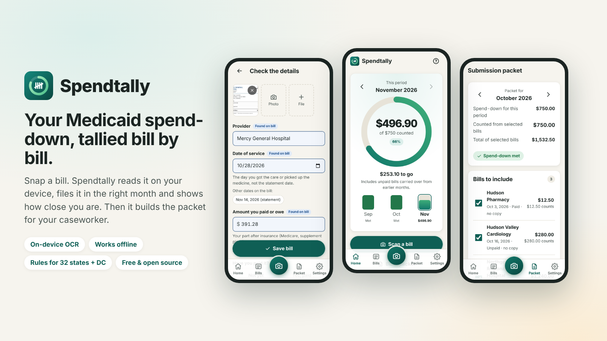

</div>

---

## Why Spendtally?

Some older and disabled people earn slightly too much to qualify for Medicaid. Many states let them qualify anyway through a **spend-down** (also called the _medically needy_ program, _excess income_, _share of cost_ or a _Medicaid deductible_). It works like a monthly deductible: once their medical bills pass the gap between their income and the state limit, Medicaid turns on.

Each period they have to collect bills, sort them by **month of service**, send them in, and keep track of which bills have already been counted. The rules are unforgiving:

- Spend-down periods run from **one to six months**, depending on the state. Some states want bills; others also take a monthly payment ([Medicare Interactive](https://www.medicareinteractive.org/understanding-medicare/cost-saving-programs/medicare-and-medicaid/spend-down-program-for-beneficiaries-with-incomes-over-the-medicaid-limit)).
- **Paid bills count only in the month of service.** An **unpaid bill from a Medicaid provider turns coverage on for just one month.** The part of a bill used for the spend-down is **never covered** ([CSS New York, 2026](https://bplc.cssny.org/files/attachment/d68a9d7d-821b-4ae3-95ae-d09553c2fa11/Best%20Practices%20for%20Medicaid%20Spenddown.pdf)).
- Every state publishes its own explainer, for example [Washington](https://hca.wa.gov/assets/free-or-low-cost/spenddown-webinar-faq.pdf) and [Missouri](https://mydss.mo.gov/spend-down).

Until now there were only explainer pages, PDFs, and one educational calculator that doesn't track bills. **Spendtally tracks every bill against your spend-down, period by period.**

## Features

|                                 |                                                                                                                                                                                                                                                                                  |
| ------------------------------- | -------------------------------------------------------------------------------------------------------------------------------------------------------------------------------------------------------------------------------------------------------------------------------- |
| 📸 **Snap a bill**              | Take a photo of a bill or receipt. On-device OCR (Tesseract.js) reads the **date of service, provider and amount** and files the bill in the right month. Every detected field is marked so you can check it, with one-tap alternatives for other dates and amounts on the page. |
| ⭕ **Progress ring**            | See how close you are to meeting this period's spend-down, with a strip of recent months (or the months of a 3- or 6-month period).                                                                                                                                              |
| 🧮 **A real spend-down ledger** | Paid bills count only in their month. Unpaid bills carry over while still owed. Medicaid-provider bills work once. Bills already sent are locked so they are never double-counted. [Details →](docs/SPEND-DOWN-RULES.md)                                                         |
| ⚠️ **Plain-language warnings**  | The one-month rule, providers that don't take Medicaid, "your share is never covered", paid-in-another-month, possible duplicates, future dates and missing copies.                                                                                                              |
| 📄 **Submission packet**        | A fax-ready PDF: a **cover sheet**, a **bill list with totals** (subtotals by month) and **copies of every bill**. Your name and Medicaid ID are on every page. Download, share or print.                                                                                        |
| 🗺️ **State rules**              | One reviewed, sourced rules file per state ([32 states + DC](#supported-states)): period length, how to send bills, pay-in option and more. "Another state" works too.                                                                                                           |
| 🔒 **Private by design**        | No account, no server, no tracking. Bills and photos stay in your browser's storage. OCR runs on your device. Backups are a file you control.                                                                                                                                    |
| 📶 **Works offline**            | An installable PWA. The bill reader downloads once (~7 MB) and then works without a connection.                                                                                                                                                                                  |
| 👓 **Made for older eyes**      | 18 px base text, three text sizes, large tap targets, high contrast, dark mode, reduced-motion support and screen-reader labels.                                                                                                                                                 |

## Screenshots

<table>
  <tr>
    <td align="center">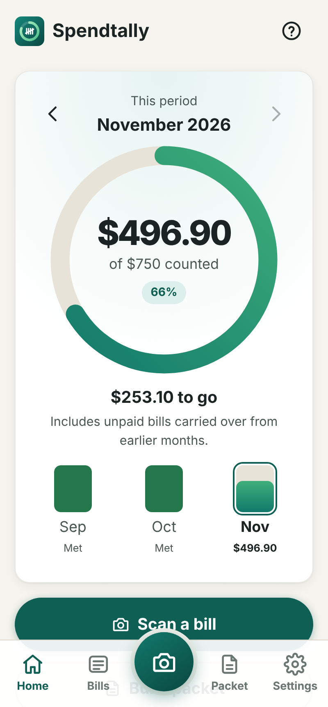<br /><sub><b>Progress ring</b><br />$496.90 of $750 counted</sub></td>
    <td align="center">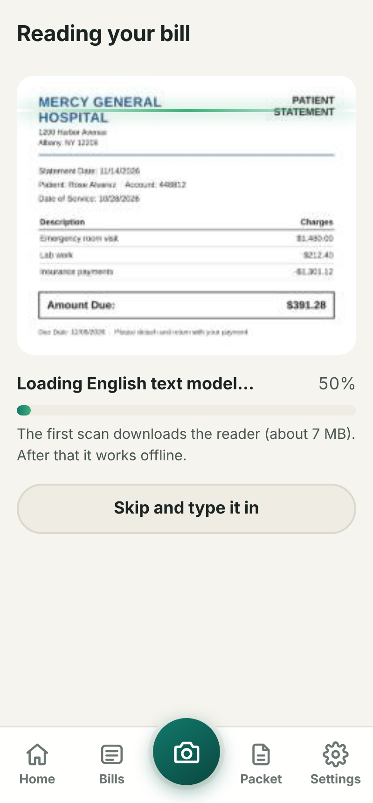<br /><sub><b>Reads the bill on your device</b></sub></td>
    <td align="center">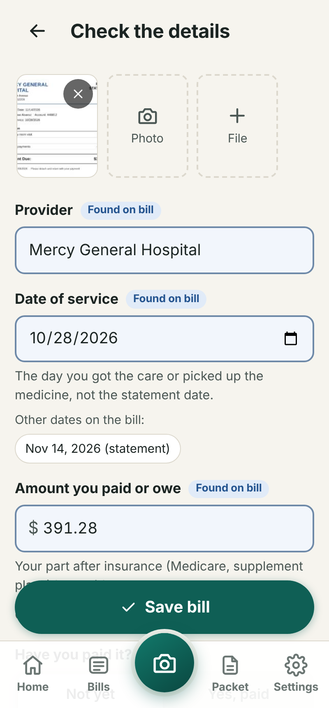<br /><sub><b>Check what it found</b></sub></td>
  </tr>
  <tr>
    <td align="center">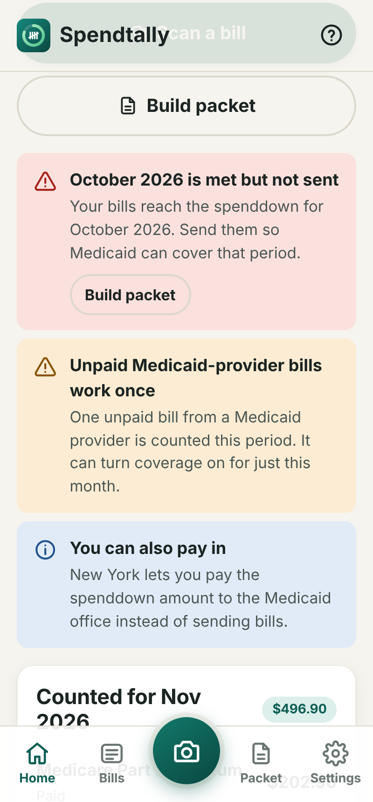<br /><sub><b>Warnings that matter</b></sub></td>
    <td align="center">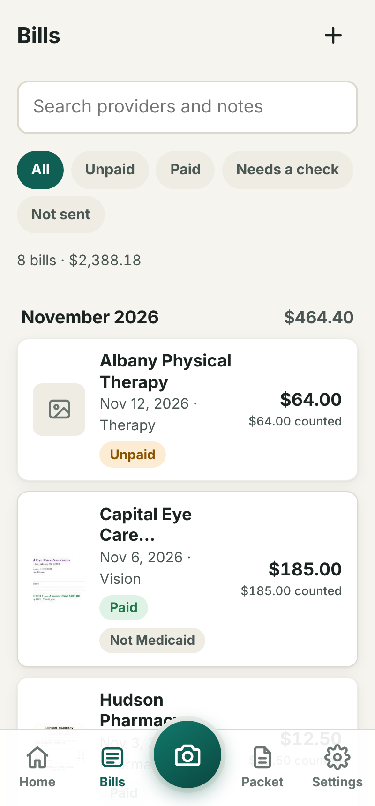<br /><sub><b>Bills by month of service</b></sub></td>
    <td align="center">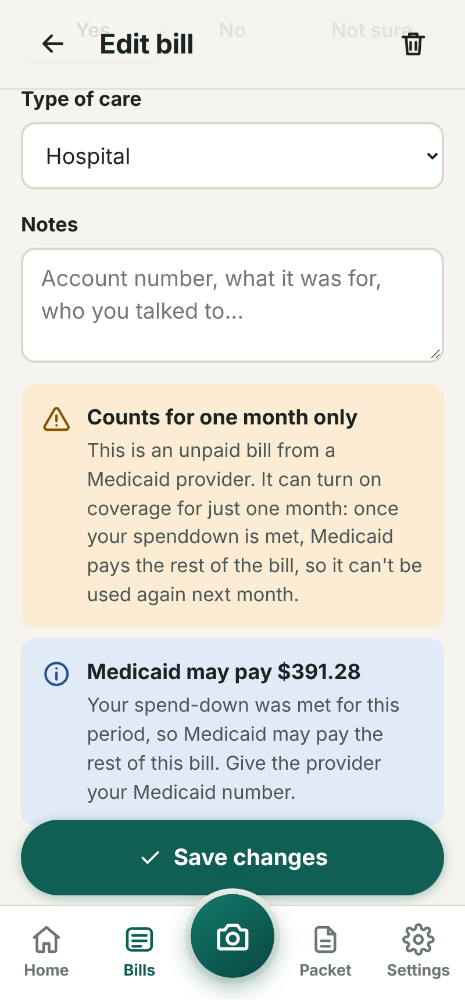<br /><sub><b>Per-bill guidance</b></sub></td>
  </tr>
  <tr>
    <td align="center">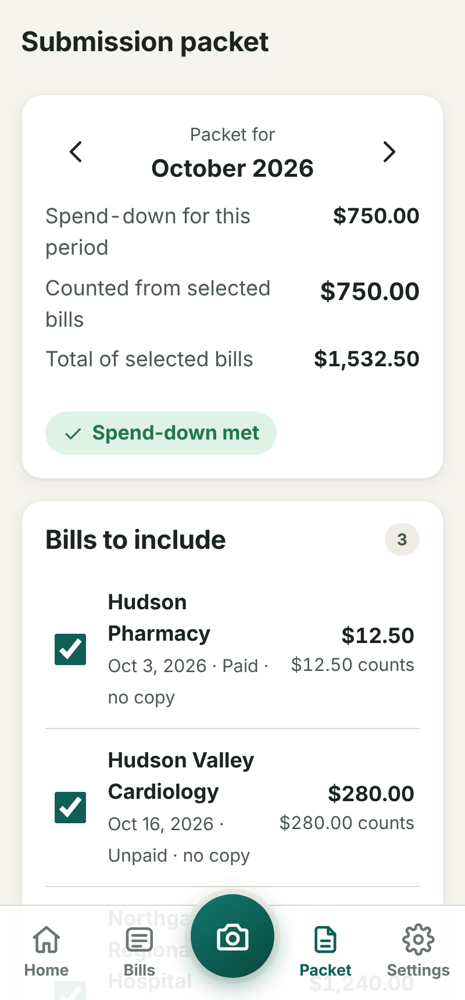<br /><sub><b>Build the packet</b></sub></td>
    <td align="center">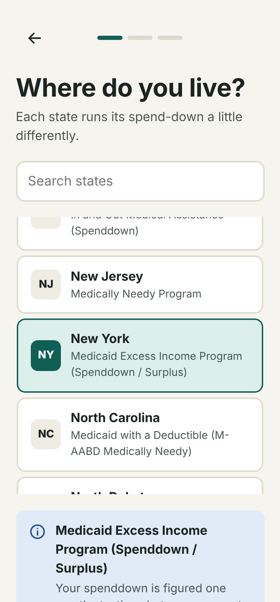<br /><sub><b>Pick your state</b></sub></td>
    <td align="center">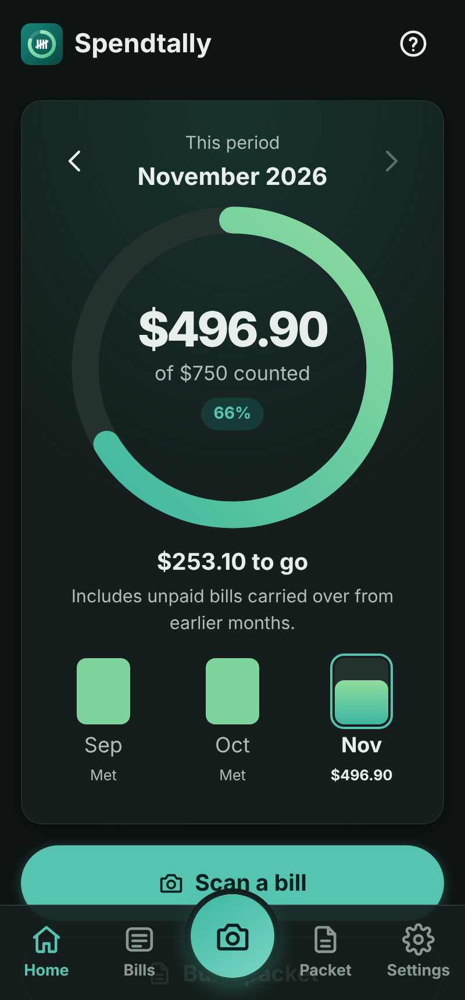<br /><sub><b>Dark mode</b></sub></td>
  </tr>
</table>

### The packet

<table>
  <tr>
    <td align="center">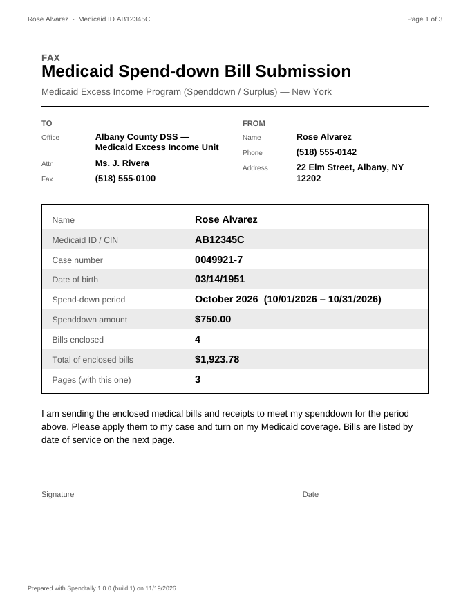<br /><sub>Cover sheet</sub></td>
    <td align="center">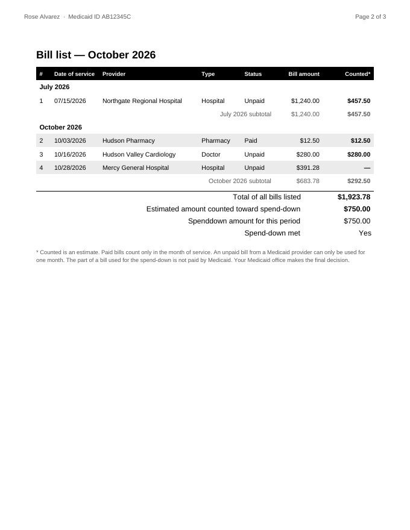<br /><sub>Bill list with totals</sub></td>
    <td align="center">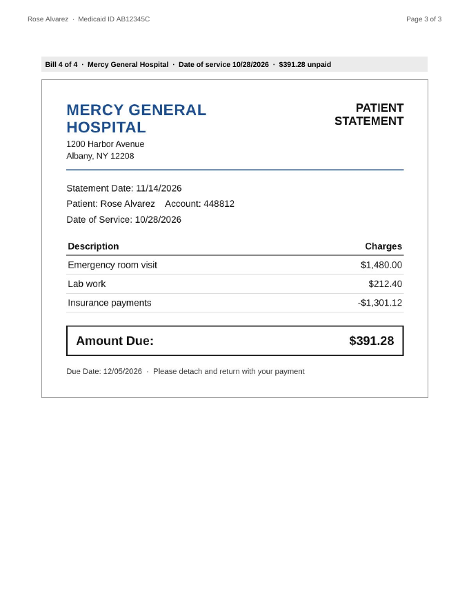<br /><sub>Labeled bill copies</sub></td>
  </tr>
</table>

See a full example: [`docs/images/sample-packet.pdf`](docs/images/sample-packet.pdf). All names and numbers in the screenshots are made up.

## Install

Spendtally is a Progressive Web App. Nothing to download from an app store:

1. Open **<https://lobojoel2003.github.io/Spendtally/>** on your phone or computer.
2. **iPhone / iPad (Safari):** tap _Share_ → _Add to Home Screen_. **Android (Chrome):** tap _Install app_. **Desktop (Chrome / Edge):** click the install icon in the address bar.
3. Optional: in **Settings → Your data**, tap _Download bill reader for offline use_.

To host it yourself, download `spendtally-<version>-build.<n>-web.zip` from the [latest release](https://github.com/lobojoel2003/Spendtally/releases/latest) and unzip it onto any static web server with HTTPS. To serve it from a sub-folder, build it with `BASE_PATH=/your-folder/ npm run build`.

## How it works

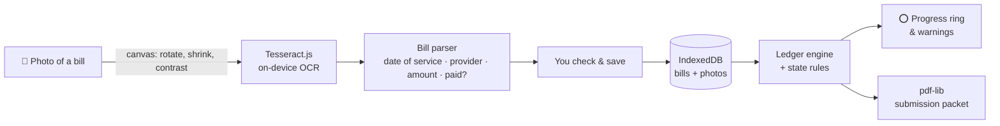

The ledger walks every period in order and applies bills in the order that preserves the most value for the person:

1. Bills already **sent** for the period (locked, exactly as sent).
2. **Paid** bills from the period. They expire with it.
3. **Unpaid** bills from providers that don't take Medicaid (or might not).
4. Older **unpaid balances carried over** from earlier periods.
5. Unpaid bills from **Medicaid providers**, last, because Medicaid pays whatever is left of those once the spend-down is met.

Then it settles each bill. Leftover paid amounts expire. Leftover unpaid balances carry forward (if the state allows). Medicaid-provider bills in a met period are marked _Medicaid may pay_ and closed. The full rules, with sources, are in [docs/SPEND-DOWN-RULES.md](docs/SPEND-DOWN-RULES.md). **Spendtally gives estimates. The Medicaid office makes the final decision.**

## Supported states

Each file in [`rules/states/`](rules/states) follows the [JSON schema](rules/schema.json) and lists its sources, review date and confidence. `—` means not confirmed yet, not "no". Corrections are very welcome: see [Updating state rules](CONTRIBUTING.md#updating-state-rules).

<!-- states:start -->

| State                | Program                                              | Period        | Send bills by                | Pay-in | Confidence |
| -------------------- | ---------------------------------------------------- | ------------- | ---------------------------- | ------ | ---------- |
| Arkansas             | AABD Medically Needy Spend-Down                      | 3 months      | Mail, In person              | —      | 🟡 Medium  |
| California           | Medi-Cal with a Share of Cost (Medically Needy)      | 1 month       | Mail, In person              | —      | 🟡 Medium  |
| Connecticut          | HUSKY C Medicaid with a Spend-Down                   | 6 months      | Mail, Fax, In person         | —      | 🟢 High    |
| District of Columbia | DC Medicaid Spend Down (Medically Needy)             | 1 month       | Mail, In person              | —      | 🟡 Medium  |
| Florida              | Medically Needy Program                              | 1 month       | Upload, Fax, Mail, In person | —      | 🟢 High    |
| Georgia              | ABD Medically Needy (AMN)                            | 1 month       | Upload, Mail, In person      | —      | 🟡 Medium  |
| Hawaii               | Med-QUEST Medically Needy Spend-Down                 | 1 month       | Mail, In person              | —      | 🟠 Low     |
| Illinois             | Medicaid Spenddown (including Pay-In Spenddown)      | 1 month       | Mail, In person              | Yes    | 🟢 High    |
| Iowa                 | Medically Needy Medical Assistance (Spenddown)       | 2 months      | Mail, In person              | —      | 🟡 Medium  |
| Kansas               | KanCare Medically Needy (Spenddown)                  | 6 months      | Mail, Fax                    | —      | 🟡 Medium  |
| Kentucky             | Medicaid Spend-down (Medically Needy)                | 3 months      | Mail, In person              | —      | 🟡 Medium  |
| Louisiana            | Spend-Down Medically Needy Program (MNP)             | 3 months      | Mail, In person              | —      | 🟡 Medium  |
| Maine                | MaineCare Medically Needy (Deductible / Spenddown)   | 6 months      | Mail, In person              | —      | 🟡 Medium  |
| Maryland             | Medically Needy Medical Assistance (Spend-down)      | 6 months      | Mail, In person              | —      | 🟡 Medium  |
| Massachusetts        | MassHealth Standard with a Deductible                | 6 months      | Mail, Fax                    | —      | 🟡 Medium  |
| Michigan             | Medicaid with a Deductible (Group 2 Medicaid)        | 1 month       | Upload, In person            | —      | 🟢 High    |
| Minnesota            | Medical Assistance with a Spenddown (MA-ABD)         | 1 month       | Mail, In person              | Yes    | 🟡 Medium  |
| Missouri             | MO HealthNet Spend Down                              | 1 month       | Upload, Email, Fax, Mail     | Yes    | 🟢 High    |
| Montana              | Montana Medicaid Medically Needy                     | 1 month       | Mail, In person              | Yes    | 🟡 Medium  |
| Nebraska             | Medically Needy Medicaid (Share of Cost)             | 1 month       | Mail                         | —      | 🟡 Medium  |
| New Hampshire        | In and Out Medical Assistance (Spenddown)            | 1 or 6 months | Mail, In person              | —      | 🟡 Medium  |
| New Jersey           | Medically Needy Program                              | 6 months      | Mail, In person              | —      | 🟡 Medium  |
| New York             | Medicaid Excess Income Program (Spenddown / Surplus) | 1 or 6 months | Fax, Mail, In person         | Yes    | 🟢 High    |
| North Carolina       | Medicaid with a Deductible (M-AABD Medically Needy)  | 6 months      | Upload, Fax, Mail, In person | —      | 🟢 High    |
| North Dakota         | Medically Needy Medicaid (Recipient Liability)       | 1 month       | Mail, In person              | —      | 🟡 Medium  |
| Pennsylvania         | Medically Needy Only (MNO) Medical Assistance        | 6 months      | Mail, In person              | —      | 🟡 Medium  |
| Rhode Island         | Community Medicaid Medically Needy (Spenddown)       | 6 months      | Mail, In person              | —      | 🟡 Medium  |
| Utah                 | Spenddown Program (Medically Needy)                  | 1 month       | Mail, In person              | Yes    | 🟢 High    |
| Vermont              | Medicaid with a Spenddown                            | 6 months      | Upload, Fax, Mail            | —      | 🟢 High    |
| Virginia             | Cardinal Care Medically Needy Spenddown              | 6 months      | Mail, In person              | —      | 🟢 High    |
| Washington           | Apple Health Medically Needy (Spenddown)             | 3 or 6 months | Fax, Mail, In person         | —      | 🟢 High    |
| West Virginia        | Medically Needy Medicaid (Spenddown)                 | 6 months      | Mail, In person              | —      | 🟡 Medium  |
| Wisconsin            | Medicaid Deductible (Elderly, Blind, or Disabled)    | 6 months      | Mail, In person              | Yes    | 🟢 High    |

<!-- states:end -->

Not listed (no medically needy pathway for older or disabled adults, or the program is closed): see [docs/research/state-rules-notes.md](docs/research/state-rules-notes.md). People in any state can pick **Another state** and set the period length themselves.

## Privacy

- **No servers, no accounts, no analytics, no cookies.** The app is static files.
- Bills, photos and settings are stored only in your browser (IndexedDB) and stay there until you delete them. Spendtally asks the browser for persistent storage so they aren't cleaned up automatically.
- OCR runs in a Web Worker on your device. The engine and English language data are served by the app itself, never by a third-party CDN.
- Backups are a JSON file you save and keep. They contain your bills and photos, so store them safely.

## Development

**Requirements:** Node.js 22 (see [`.nvmrc`](.nvmrc)) and npm.

```bash
git clone https://github.com/lobojoel2003/Spendtally.git
```

```bash
cd Spendtally && npm ci
```

```bash
npm run dev
```

| Command                                                 | What it does                                                                              |
| ------------------------------------------------------- | ----------------------------------------------------------------------------------------- |
| `npm run dev`                                           | Start the dev server (copies the OCR engine into `public/ocr` first)                      |
| `npm run build`                                         | Production build to `dist/` with the service worker                                       |
| `npm run preview`                                       | Serve the production build                                                                |
| `npm test`                                              | Unit tests (Vitest): ledger, OCR parser, packet PDF, backups, rules                       |
| `npm run test:coverage`                                 | Unit tests with coverage                                                                  |
| `npm run test:e2e`                                      | End-to-end tests (Playwright, mobile Chromium) against `dist/`, including a real OCR scan |
| `npm run lint` · `npm run typecheck` · `npm run format` | ESLint, TypeScript, Prettier                                                              |
| `npm run validate:rules`                                | Validate every state rules file against the schema                                        |
| `npm run check`                                         | Lint + types + rules + unit tests (what CI runs first)                                    |
| `npm run docs:states`                                   | Regenerate the state table in this README                                                 |
| `npm run screenshots`                                   | Regenerate the README images from a production build                                      |
| `npm run icons`                                         | Render the PNG app icons from the SVG logo                                                |

### Tech stack

[Preact](https://preactjs.com) + [Signals](https://preactjs.com/guide/v10/signals/) · TypeScript · [Vite](https://vite.dev) · [vite-plugin-pwa](https://vite-pwa-org.netlify.app) (Workbox) · [Tesseract.js](https://tesseract.projectnaptha.com) · [pdf-lib](https://pdf-lib.js.org) · [idb](https://github.com/jakearchibald/idb) · Vitest · Playwright.

### Project layout

```
src/
  lib/
    engine.ts        spend-down ledger (periods, carry-over, one-month rule, locking)
    warnings.ts      per-bill warnings and home-screen alerts
    periods.ts       1–6 month period math
    ocr/ocr.ts       Tesseract.js worker, self-hosted assets
    ocr/parse.ts     OCR text → date of service, provider, amount, paid status
    pdf/packet.ts    cover sheet, bill list, labeled copies (pdf-lib)
    db.ts store.ts   IndexedDB + reactive state
    backup.ts        export / import
  screens/           Welcome, Home, BillEditor, Bills, Packet, Settings, Help
  components/        ProgressRing, BillCard, AlertBox, …
rules/
  schema.json        JSON Schema for state rules
  states/XX.json     one file per state
scripts/             OCR asset copy, rule validation, icons, screenshots, release helpers
tests/unit/          Vitest
tests/e2e/           Playwright
```

## Versioning, builds and releases

- **Semantic Versioning.** `MAJOR.MINOR.PATCH` in [`package.json`](package.json), with every release described in [`CHANGELOG.md`](CHANGELOG.md) (Keep a Changelog format).
- **Build numbers.** The build number is the commit count on the release branch (`git rev-list --count HEAD`). It only goes up and can be reproduced from any checkout. The app shows it under **Settings → About** as `1.0.0 (build 42)`, next to the commit and build date. It is also in each release's file names.
- **Tags.** Every release is an annotated tag `vX.Y.Z` on `main`.
- **Releasing:**
  1. Add a `## [X.Y.Z] - YYYY-MM-DD` section to `CHANGELOG.md`.
  2. Run `npm version X.Y.Z -m "chore(release): v%s"`. This bumps `package.json`, checks the changelog, commits and tags.
  3. Run `git push --follow-tags`. The **Release** workflow checks that the tag, `package.json` and the changelog agree, runs every test, builds, and publishes a GitHub Release with the web bundle, a sample packet and `SHA256SUMS.txt`.

See [docs/RELEASING.md](docs/RELEASING.md) for details.

## CI/CD

| Workflow                                 | Trigger                       | What it does                                                                                                                                                                             |
| ---------------------------------------- | ----------------------------- | ---------------------------------------------------------------------------------------------------------------------------------------------------------------------------------------- |
| [CI](.github/workflows/ci.yml)           | Push to `main`, pull requests | Prettier, ESLint, TypeScript, state-rules schema, version/changelog check, unit tests with coverage summary → production build (artifact) → Playwright end-to-end tests on the built app |
| [Deploy](.github/workflows/deploy.yml)   | Push to `main`                | Tests, builds with the Pages base path, and publishes to GitHub Pages                                                                                                                    |
| [Release](.github/workflows/release.yml) | Tag `v*.*.*`                  | Verifies the version, runs all tests, builds, packages and publishes the GitHub Release                                                                                                  |
| [CodeQL](.github/workflows/codeql.yml)   | Push, PRs, weekly             | Static security analysis                                                                                                                                                                 |
| [Dependabot](.github/dependabot.yml)     | Weekly                        | Grouped npm and GitHub Actions updates                                                                                                                                                   |

> **One-time setup for the live app:** in the repository, open **Settings → Pages** and set **Source** to **GitHub Actions**. The next push to `main` (or a manual run of _Deploy to GitHub Pages_) publishes the app.

## Contributing

Bug reports, state rule corrections, translations and code are all welcome. Please read [CONTRIBUTING.md](CONTRIBUTING.md). Security issues: see [SECURITY.md](SECURITY.md).

## Disclaimer

Spendtally is not legal or financial advice and is not affiliated with any government agency. Medicaid rules vary by state and change over time. Always confirm with your caseworker, local legal aid office, or your [State Health Insurance Assistance Program (SHIP)](https://www.shiphelp.org/).

## License

Copyright © 2026 Joel Stain Lobo.

Spendtally is free software: you can redistribute it and/or modify it under the terms of the **GNU General Public License v3.0 or later**. See [LICENSE](LICENSE).

Built on open-source work: Tesseract.js (Apache-2.0), pdf-lib (MIT), Preact (MIT), idb (ISC) and Workbox (MIT).
